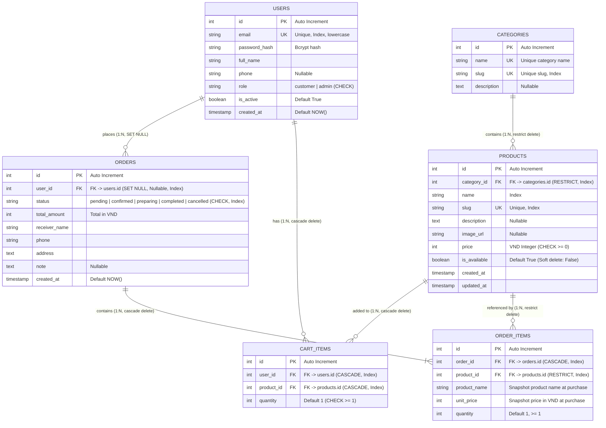

# Entity Relationship Diagram (ERD) - Highland Coffee

Tài liệu mô tả chi tiết lược đồ cơ sở dữ liệu quan hệ của hệ thống Highlands Coffee E-Commerce.

> Cập nhật lần cuối: sau migration `8f3a1c92d4b7` (thêm CHECK constraints, đổi `orders.user_id` sang nullable + `ON DELETE SET NULL`, partial index cho sản phẩm còn bán).

---

## 1. Sơ đồ thực thể ERD (Mermaid)



---

## 2. Chi tiết các bảng và ràng buộc (Constraints)

### Bảng `users`
- Khóa chính: `id` (INTEGER, SERIAL)
- `email`: VARCHAR(255), UNIQUE, NOT NULL, INDEX — luôn lưu dạng lowercase
- `password_hash`: VARCHAR(255), NOT NULL
- `full_name`: VARCHAR(255), NOT NULL
- `phone`: VARCHAR(20), **NULLABLE**
- `role`: VARCHAR(20), NOT NULL, default `'customer'`
  - **CHECK `ck_users_role`**: `role IN ('customer', 'admin')`
- `is_active`: BOOLEAN, default `TRUE`
- `created_at`: TIMESTAMP WITH TIME ZONE, default `NOW()`

### Bảng `categories`
- Khóa chính: `id` (INTEGER, SERIAL)
- `name`: VARCHAR(100), UNIQUE, NOT NULL
- `slug`: VARCHAR(120), UNIQUE, INDEX, NOT NULL
- `description`: TEXT, NULLABLE

### Bảng `products`
- Khóa chính: `id` (INTEGER, SERIAL)
- `category_id`: INTEGER, FOREIGN KEY REFERENCES `categories(id)` ON DELETE **RESTRICT**, INDEX
- `name`: VARCHAR(200), NOT NULL, INDEX
- `slug`: VARCHAR(250), UNIQUE, INDEX, NOT NULL
- `description`: TEXT, NULLABLE
- `image_url`: VARCHAR(500), NULLABLE
- `price`: INTEGER (VND), NOT NULL
  - **CHECK `ck_products_price`**: `price >= 0`
- `is_available`: BOOLEAN, default `TRUE` (Dùng cho soft-delete)
- `created_at`, `updated_at`: TIMESTAMP WITH TIME ZONE, default `NOW()`
- **Partial index `ix_products_available_id`**: `ON products(id) WHERE is_available = true` — tối ưu truy vấn danh sách sản phẩm đang bán

### Bảng `cart_items`
- Khóa chính: `id` (INTEGER, SERIAL)
- `user_id`: INTEGER, FOREIGN KEY REFERENCES `users(id)` ON DELETE **CASCADE**, INDEX
- `product_id`: INTEGER, FOREIGN KEY REFERENCES `products(id)` ON DELETE **CASCADE**, INDEX
- `quantity`: INTEGER, NOT NULL
  - **CHECK `ck_cart_items_quantity`**: `quantity >= 1`
- **Unique Constraint `uq_cart_items_user_product`**: `UNIQUE(user_id, product_id)`
  (Một user không có 2 dòng cùng 1 sản phẩm, phải cộng dồn `quantity`)

### Bảng `orders`
- Khóa chính: `id` (INTEGER, SERIAL)
- `user_id`: INTEGER, **NULLABLE**, FOREIGN KEY REFERENCES `users(id)` ON DELETE **SET NULL**, INDEX
  - Đơn hàng được giữ lại khi user bị xóa → không mất lịch sử đơn hàng
- `status`: VARCHAR(50), NOT NULL, INDEX
  - **CHECK `ck_orders_status`**: `status IN ('pending', 'confirmed', 'preparing', 'completed', 'cancelled')`
- `total_amount`: INTEGER (VND), NOT NULL
- `receiver_name`, `phone`, `address`: NOT NULL
- `note`: TEXT, NULLABLE
- `created_at`: TIMESTAMP WITH TIME ZONE, default `NOW()`

### Bảng `order_items`
- Khóa chính: `id` (INTEGER, SERIAL)
- `order_id`: INTEGER, FOREIGN KEY REFERENCES `orders(id)` ON DELETE **CASCADE**, INDEX
- `product_id`: INTEGER, FOREIGN KEY REFERENCES `products(id)` ON DELETE **RESTRICT**, INDEX
  - `RESTRICT` bảo vệ lịch sử đơn hàng: không xóa sản phẩm đã từng được đặt
- `product_name`: VARCHAR(200) (Snapshot tên tại thời điểm đặt)
- `unit_price`: INTEGER (Snapshot giá tại thời điểm đặt)
- `quantity`: INTEGER, NOT NULL

---

## 3. Ma trận ràng buộc xóa (ON DELETE)

| Bảng con | Cột FK | Cột cha | ON DELETE | Hành vi |
|---|---|---|---|---|
| `cart_items` | `user_id` | `users.id` | CASCADE | Xóa user → xóa giỏ hàng |
| `cart_items` | `product_id` | `products.id` | CASCADE | Xóa product → xóa dòng giỏ |
| `orders` | `user_id` | `users.id` | **SET NULL** | Xóa user → giữ đơn, `user_id = NULL` |
| `order_items` | `order_id` | `orders.id` | CASCADE | Xóa order → xóa item |
| `order_items` | `product_id` | `products.id` | RESTRICT | Không xóa product đã có đơn |
| `products` | `category_id` | `categories.id` | RESTRICT | Không xóa category còn sản phẩm |

---

## 4. Luật chuyển đổi trạng thái đơn hàng (State Transition Rules)

```text
               ┌──────────┐
               │ pending  │
               └────┬─────┘
                    │ (Xác nhận đơn)
                    ▼
               ┌──────────┐
      ┌───────►│ confirmed │───────┐
      │        └────┬─────┘        │
      │             │ (Pha chế)    │ (Hủy đơn)
      │             ▼              ▼
      │        ┌──────────┐   ┌───────────┐
      │        │preparing │   │ cancelled │ (Terminal)
      │        └────┬─────┘   └───────────┘
      │             │ (Hoàn tất)
      │             ▼
      │        ┌───────────┐
      └────────│ completed │ (Terminal)
               └───────────┘

   ※ Bất kỳ trạng thái nào ngoài terminal đều có thể chuyển sang 'cancelled'.
     'completed' và 'cancelled' là trạng thái cuối, không thể thay đổi tiếp.
```

Quy tắc chuyển trạng thái được enforce ở tầng API (`backend/app/api/routes/orders.py`), trạng thái ngoài danh sách hợp lệ bị từ chối bởi CHECK constraint `ck_orders_status`.
