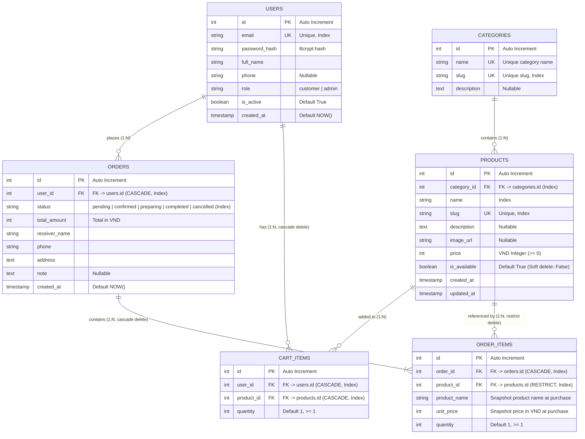

# Entity Relationship Diagram (ERD) - Highland Coffee

Tài liệu mô tả chi tiết lược đồ cơ sở dữ liệu quan hệ của hệ thống Highlands Coffee E-Commerce.

---

## 1. Sơ đồ thực thể ERD (Mermaid)



---

## 2. Chi tiết các bảng và Ràng buộc (Constraints)

### Bảng `users`
- Khóa chính: `id` (INTEGER, SERIAL)
- `email`: UNIQUE, NOT NULL, INDEX
- `password_hash`: VARCHAR(255), NOT NULL
- `role`: VARCHAR(20), NOT NULL, default `'customer'` (`'customer'` hoặc `'admin'`)
- `is_active`: BOOLEAN, default `TRUE`
- `created_at`: TIMESTAMP WITH TIME ZONE, default `NOW()`

### Bảng `categories`
- Khóa chính: `id` (INTEGER, SERIAL)
- `name`: VARCHAR(100), UNIQUE, NOT NULL
- `slug`: VARCHAR(120), UNIQUE, INDEX, NOT NULL
- `description`: TEXT

### Bảng `products`
- Khóa chính: `id` (INTEGER, SERIAL)
- `category_id`: INTEGER, FOREIGN KEY REFERENCES `categories(id)` ON DELETE RESTRICT, INDEX
- `name`: VARCHAR(200), NOT NULL, INDEX
- `slug`: VARCHAR(250), UNIQUE, INDEX, NOT NULL
- `price`: INTEGER (VND, >= 0)
- `is_available`: BOOLEAN, default `TRUE` (Dùng cho soft-delete)
- `created_at`, `updated_at`: TIMESTAMP WITH TIME ZONE

### Bảng `cart_items`
- Khóa chính: `id` (INTEGER, SERIAL)
- `user_id`: INTEGER, FOREIGN KEY REFERENCES `users(id)` ON DELETE CASCADE, INDEX
- `product_id`: INTEGER, FOREIGN KEY REFERENCES `products(id)` ON DELETE CASCADE, INDEX
- `quantity`: INTEGER, NOT NULL, >= 1
- **Unique Constraint**: `UNIQUE(user_id, product_id)` (Một user không có 2 dòng cùng 1 sản phẩm, mà cộng dồn `quantity`)

### Bảng `orders`
- Khóa chính: `id` (INTEGER, SERIAL)
- `user_id`: INTEGER, FOREIGN KEY REFERENCES `users(id)` ON DELETE CASCADE, INDEX
- `status`: VARCHAR(50), NOT NULL, INDEX (Gồm: `pending`, `confirmed`, `preparing`, `completed`, `cancelled`)
- `total_amount`: INTEGER (VND)
- `receiver_name`, `phone`, `address`: NOT NULL
- `note`: TEXT, NULLABLE
- `created_at`: TIMESTAMP WITH TIME ZONE

### Bảng `order_items`
- Khóa chính: `id` (INTEGER, SERIAL)
- `order_id`: INTEGER, FOREIGN KEY REFERENCES `orders(id)` ON DELETE CASCADE, INDEX
- `product_id`: INTEGER, FOREIGN KEY REFERENCES `products(id)` ON DELETE RESTRICT, INDEX
- `product_name`: VARCHAR(200) (Snapshot tên tại thời điểm đặt)
- `unit_price`: INTEGER (Snapshot giá tại thời điểm đặt)
- `quantity`: INTEGER, NOT NULL

---

## 3. Luật chuyển đổi trạng thái đơn hàng (State Transition Rules)

```text
               ┌───────────┐
               │  pending  │
               └─────┬─────┘
                     │ (Xác nhận đơn)
                     ▼
               ┌───────────┐
      ┌───────>│ confirmed │─────────┐
      │        └─────┬─────┘         │
      │              │ (Pha chế)     │ (Hủy đơn)
      │              ▼               │
      │        ┌───────────┐         │
      │        │ preparing │         │
      │        └─────┬─────┘         │
      │              │ (Hoàn tất)    ▼
      │              ▼         ┌───────────┐
      │        ┌───────────┐   │ cancelled │ (Terminal)
      │        │ completed │   └───────────┘
      │        └───────────┘
      │          (Terminal)
      │
      └─ Bất kỳ trạng thái nào ngoài terminal đều có thể chuyển sang 'cancelled'.
         'completed' và 'cancelled' là trạng thái cuối, không thể thay đổi tiếp.
```
